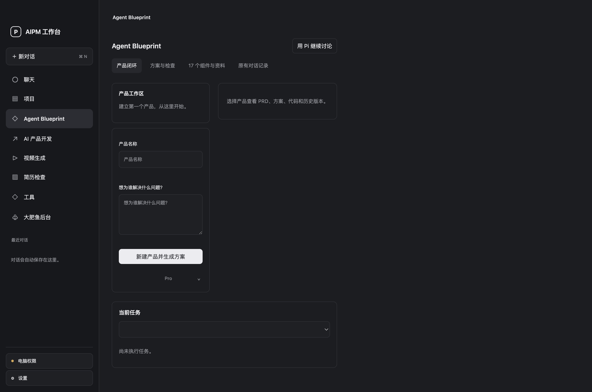
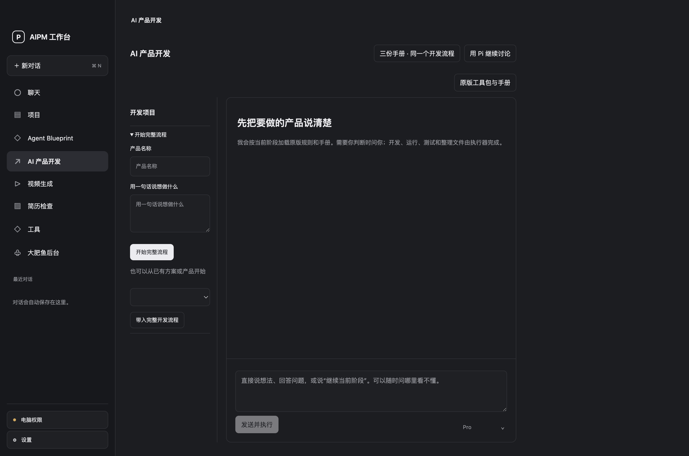
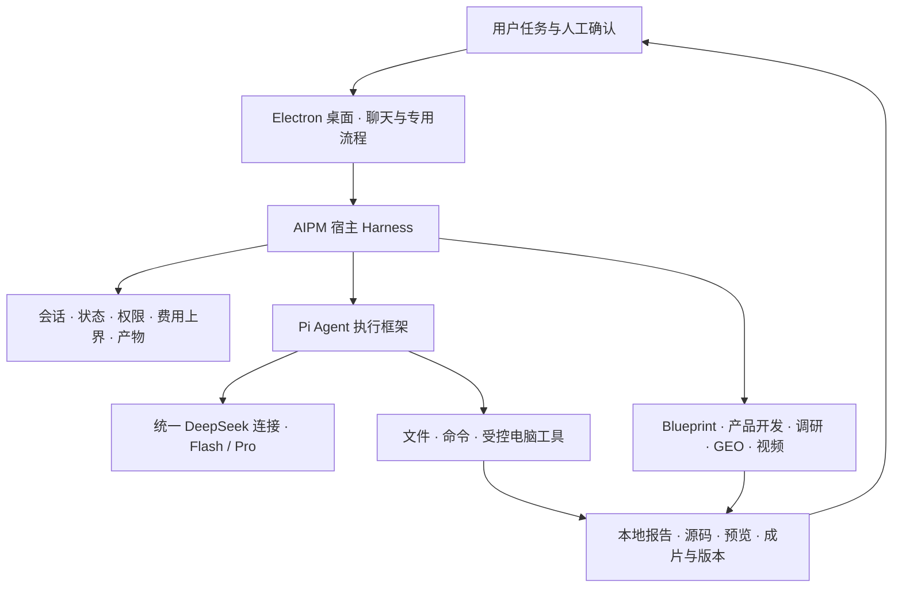

<div align="center">


**面向 AI 产品经理的个人 Agent 工作台**

用自然语言推进调研、开发与创作，在本机查看过程、检查产物并继续修改。

[**打开产品介绍 ↗**](https://yemin11238.github.io/AIPM-Workbench/) · [产品设计](docs/PRODUCT.md) · [Harness 架构](docs/ARCHITECTURE.md) · [本地运行](docs/SETUP.md) · [验证记录](docs/VALIDATION.md)


</div>

## 从一个真实问题开始

产品想法可以在聊天里说清楚，继续往下做时却常常卡住。开发工具需要重新配置，调研资料散在不同目录，模型说“完成”之后，还要自己找文件、运行代码并判断结果是否可用。

**AIPM 将聊天、项目资料与实际执行放进一个桌面工作台。** 用户提出任务，Agent 调用本地工具；界面呈现执行记录与产物，用户检查结果，再继续推进。


> 这是个人原创产品实践。产品定位、交互设计、工作台界面、宿主控制与业务适配由张俊豪主导，通过 AI 辅助开发实现。执行框架与部分专用能力采用开源项目，来源与许可证见 [第三方说明](THIRD_PARTY_NOTICES.md)。

## 三个使用场景

| 用户想完成的事 | 工作台如何支持 | 最后检查什么 |
| --- | --- | --- |
| 把想法做成可运行原型 | 导入 PRD，核对需求和技术选择，分阶段推进后端、前端与部署准备 | 源文件、测试记录、本地预览和人工阶段确认 |
| 了解公司并准备客户拜访 | 在同一项目补充资料、记录公开来源，与 Agent 讨论报告 | 事实缺口、来源、报告版本及导出文件 |
| 制作一段产品介绍视频 | 同项目内讨论需求，编辑分镜，交接本地制片，再内嵌播放和导出 | 关键帧、声音、播放效果与用户审阅 |

GEO 内容运营、产品梳理和简历检查作为专用流程保留。桌面文件与支持的应用操作可以从主聊天发起。

## 产品里最关键的几个选择

- **聊天负责推进任务，专页负责检查产物。** 高频入口放在侧栏，日志按需展开，视频在工作台内播放。
- **宿主管执行。** Pi 负责模型交互与工具调用，工作台管理会话、权限、任务限制、模型配置和产物记录。
- **阶段验收交给用户。** 代码执行成功、文件合格和用户认可分别判断；模型不能替用户填写评分或批准操作。
- **同一套主要模型配置。** 聊天和主要业务模块共用已保存的连接，输入区可以切换 Flash / Pro，进行中的任务保持原模型。
- **在项目里继续修改。** 公司调研和视频各自绑定持久会话；历史版本保留。主聊天与 AI 产品开发的阶段状态仍分别管理。

<details>
<summary><strong>查看真实功能界面</strong></summary>

### Agent Blueprint

保留产品方案、代码骨架、方案检查、17 个组件资料及原有对话入口。



### AI 产品开发

围绕 PRD 检查、技术适配、后端 MVP、正式前端、部署与收尾组织六阶段流程。



### 视频工作区

同一页面讨论、制作、预览和导出；截图使用空白演示工作区，不展示个人作品。


</details>

## Agent Harness 架构



Pi 提供 Agent 的执行能力，AIPM 负责将能力组织为面向产品工作的应用。[查看模块职责和代码入口 →](docs/ARCHITECTURE.md)

## 当前进度与验证

- 已形成可在本机运行的 macOS 桌面版本，包含真实文件、命令和部分应用操作记录。
- 已整理 17 条需求与 18 条初始评测用例。评测方案是初稿，18 条并未全部执行。
- 模拟接口检查、本地媒体检查与真实模型任务分开记录，不把文件存在或测试通过写成内容质量达标。
- 公开仓库的本轮检查范围及结果见 [验证记录](docs/VALIDATION.md)。这里不声明外部用户规模、效率提升比例或统一模型胜率。

## 本地运行

要求 macOS、Node.js 24+、Python 3，以及可编译原生桥的 Xcode Command Line Tools。当前原生窗口材质使用较新的 macOS SDK。

```bash
git clone https://github.com/YEMIN11238/AIPM-Workbench.git
cd AIPM-Workbench
npm ci
npm run build:ui
npm start
```

在应用设置中填入自己的 API Key。默认数据目录位于 `~/Library/Application Support/AIPM-Workbench`，可以用 `AIPM_HOME` 指定其它位置。[分模块配置和完整要求 →](docs/SETUP.md)

公开仓库包含工作台源码、公开上游资源和适配器。课程私有资料、个人研究资料、模型权重、浏览器与 FFmpeg 二进制以及私人运行数据未随源码发布。基础聊天和界面构建与这些可选资源分别配置，具体范围在运行说明中列明。

## 面试时可以从这里看

1. [产品设计](docs/PRODUCT.md) · 需求从哪里来，为什么这样组织入口与流程。
2. [架构说明](docs/ARCHITECTURE.md) · 模型、Pi、Harness 与业务模块各自负责什么。
3. [验证记录](docs/VALIDATION.md) · 如何区分任务执行、产物质量和用户验收。
4. [原创与第三方边界](THIRD_PARTY_NOTICES.md) · 自己做了哪些工作，依赖哪些开源组件。

## 作者与许可

**张俊豪 · AI 产品经理方向个人项目**

[GitHub / YEMIN11238](https://github.com/YEMIN11238)

原创部分的权利说明见 [COPYRIGHT.md](COPYRIGHT.md)。第三方代码、模板与资源保留各自许可；本仓库目前为公开展示与技术交流提供源码，未对原创部分额外授予开源许可。
