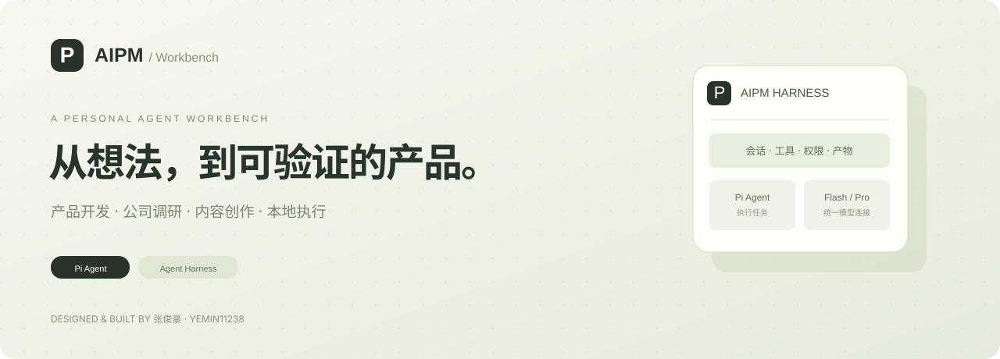
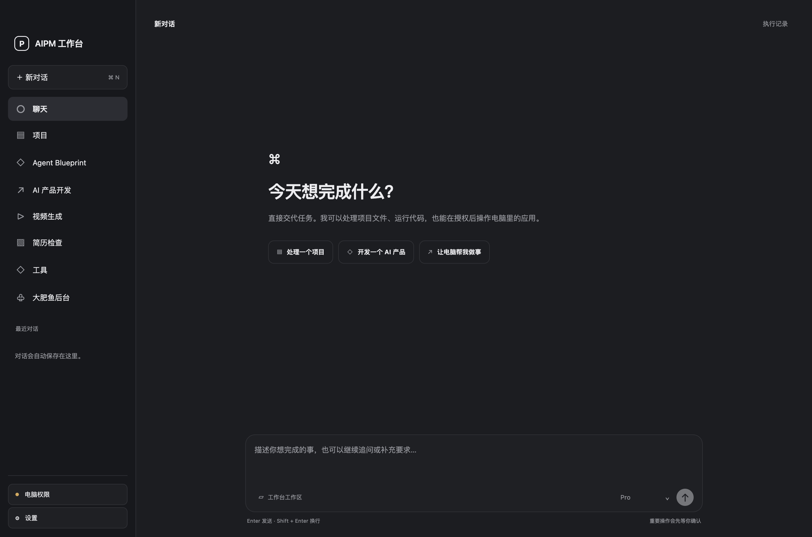
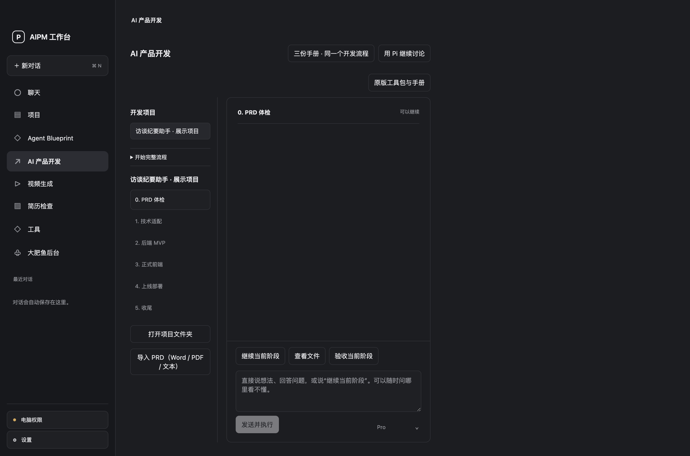
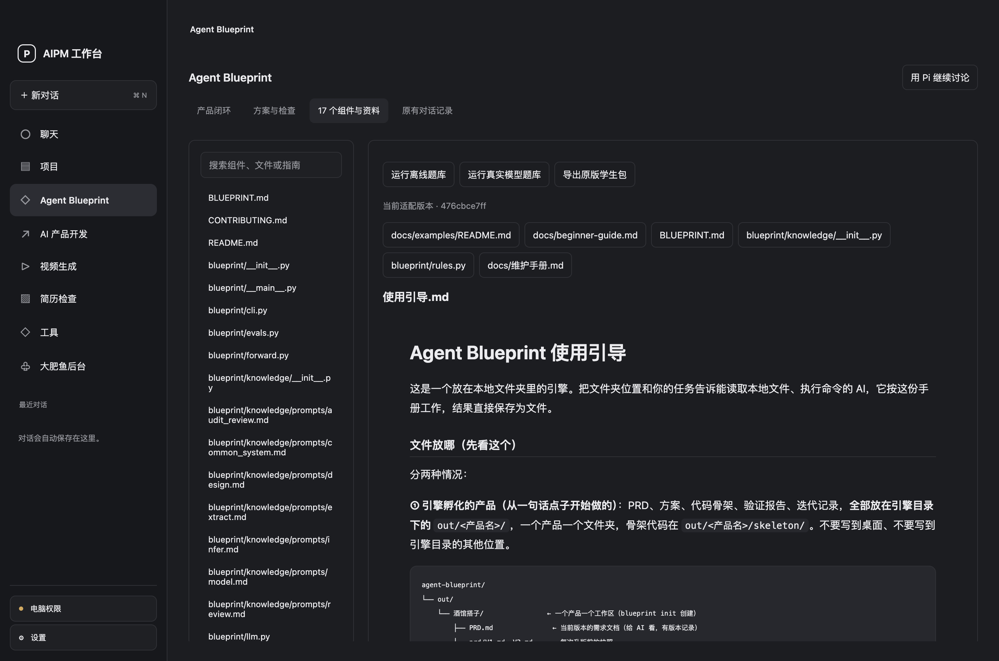
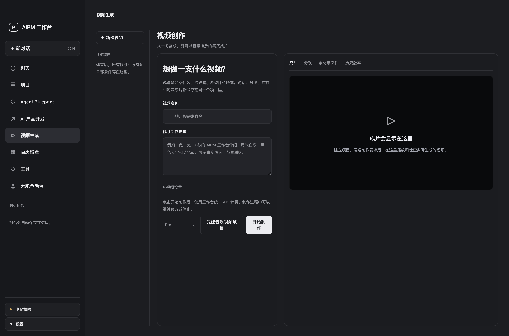
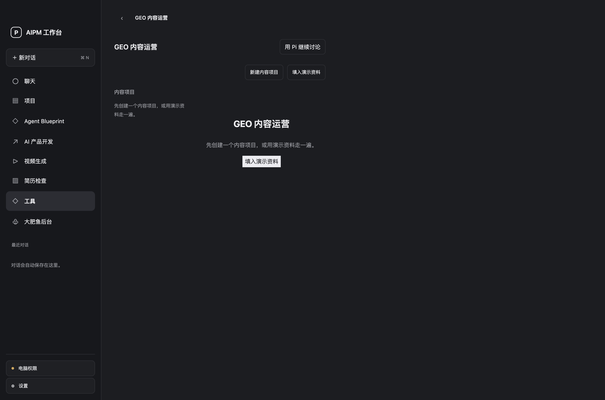
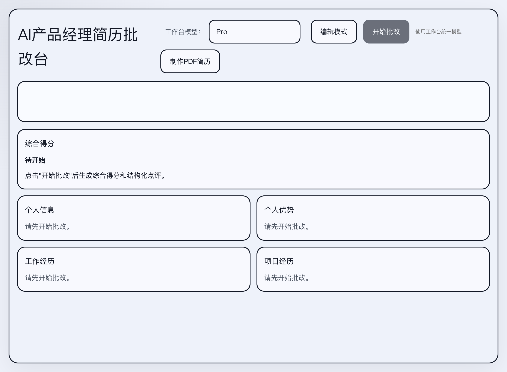
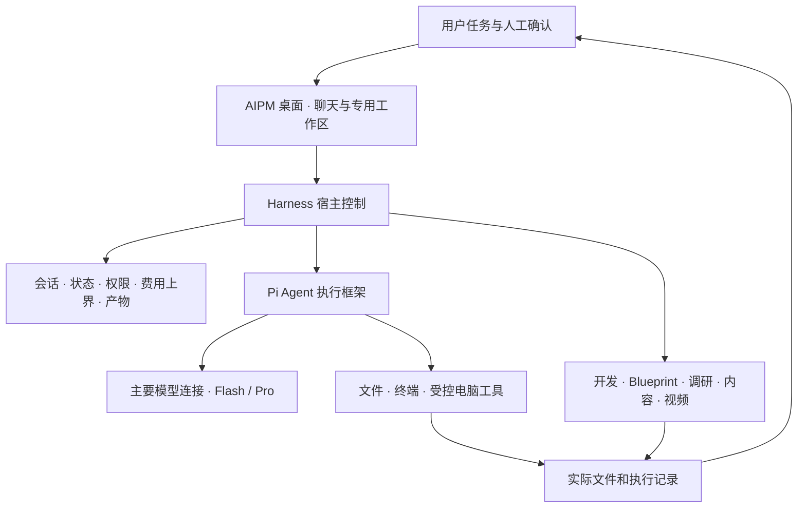

<div align="center">



**面向 AI 产品经理的个人 AI Coding 与 Agent 工作台**

一句需求之后，继续读写文件、运行代码、操作支持的应用，交付能查看和修改的结果。

[**打开完整介绍与任务回放 ↗**](https://yemin11238.github.io/AIPM-Workbench/) · [完整功能](#可以交给-aipm-的工作) · [实际验证](docs/EVIDENCE.md) · [产品设计](docs/PRODUCT.md) · [面试讲解](docs/INTERVIEW.md)

[](https://github.com/YEMIN11238/AIPM-Workbench/actions/workflows/check.yml)


</div>

## 从一个需求，推进到实际产物

AIPM 将产品工作里的对话、文件和执行组织在一个 macOS 工作台里。选择项目目录，告诉 Agent 要完成什么，它可以读取资料、修改代码和运行命令；获得授权后，还能读取支持的应用界面，执行点击与输入。

产品开发、公司调研和视频等复杂任务各有专用页面。用户能在工作台里看进度、检查文件和报告、播放视频，并在原项目中继续修改。



**张俊豪主导产品定位、需求、交互、宿主控制与业务适配，通过 AI 辅助开发实现。** Pi 与专用开源项目承担各自的框架或工具职责，保留来源与许可证。

## 它怎样把任务往下做

### 场景一 · 从 Agent 方案到代码迭代

用户提出产品目标，工作台整理方案并生成代码骨架。用户打开文件、运行检查，再提出新需求，继续推进版本。

| 环节 | 工作台提供的支持 | 已有验证 |
| --- | --- | --- |
| 方案 | 产品目标、能力划分、待确认问题 | 产品方案与代码流程保留 |
| 代码 | 生成代码骨架，打开真实目录和文件 | 已有生成代码记录 |
| 运行 | 在当前产品上执行并查看结果 | 既有示例完成两次运行 |
| 迭代 | 新需求推动升版，保留旧结果 | 既有示例推进至 V2，V1 输出保留 |

[在介绍页逐步查看任务回放 →](https://yemin11238.github.io/AIPM-Workbench/#replay) · [核对匿名技术摘要 →](docs/evidence/verified-capabilities.json)

### 场景二 · 在电脑上完成具体操作

已有 TextEdit 验证按以下顺序执行，动作后重新观察，最后保留截图。

```text
找到目标应用 → 读取窗口 → 点击控件 → 再次读取
            → 输入内容 → 读回核对 → 捕获截图
```

主聊天中的文件与终端工具可以处理已有项目。桌面工具接入 macOS 辅助功能、窗口截图和本机 OCR，用于支持的应用操作。[查看实际记录与范围 →](docs/EVIDENCE.md)

## 可以交给 AIPM 的工作

| 工作区 | 你提供什么 | 工作台怎样推进 | 你能查看什么 |
| --- | --- | --- | --- |
| **AI Coding 与电脑操作** | 项目目录、代码修改或具体操作任务 | 读取、搜索、编辑、执行命令；观察后操作支持的应用 | 文件、命令结果、执行详情、窗口截图 |
| **AI 产品开发** | 想法或 Word / PDF / Markdown PRD | 六阶段推进，按阶段读取手册，真人核对后继续 | PRD、代码、测试证据、预览、评分与阶段文件 |
| **Agent Blueprint** | Agent 产品目标、方案或已有项目 | 方案、骨架、差距检查、运行和升版；查看 17 个组件 | 产品方案、代码骨架、运行与历史版本 |
| **公司与客户调研** | 公司名称、拜访目标、链接和补充材料 | 三种模式与三档深度，记录来源，在同一 Pi 会话补充 | 报告、来源账本、缺口、版本与离线 HTML |
| **视频创作** | 需求、风格、时长、画幅和素材 | 同项目讨论与分镜，模型创作交接本地制片 | 分镜、源码、内嵌成片、历史版本与导出包 |
| **GEO 内容运营** | 客户事实、来源、关键词和选题 | 形成主稿，适配头条、搜狐、知乎、36氪，人工审阅 | 主稿、平台稿件、审核记录与九文件导出包 |
| **产品梳理与文档** | 想法、用户问题和已有证据 | 整理需求池、竞品、MVP、立项与 PRD，阶段确认 | 可编辑文档、证据与历史版本 |
| **简历检查** | 用户主动输入的简历 | 检查与优化，在本地编辑页继续修改 | 建议、草稿与八套 PDF 模板 |
| **大肥鱼后台** | 独立云端连接、账号和模型配置 | 经 SSH 隧道进入云端 AstrBot 原版后台 | 可继续管理的后台与连接状态 |

介绍页中的九张功能卡可以打开输入、执行方式、产物与实际界面说明。主要业务共用模型配置，大肥鱼保留独立的远程凭据。

## 六阶段产品开发

```text
PRD 体检 → 技术适配 → 后端 MVP → 正式前端 → 上线部署 → 收尾
```

从想法开始也可以导入现有 PRD。三份技术与部署手册在同一个流程中使用，阶段报告、决策和样例评分留在项目里。真实命令、测试与预览用于检查产物，用户核对后再确认推进。



主聊天适合直接处理选定目录，专用开发页提供阶段管理与人工确认。两者的阶段状态分别管理。

## 让修改接得上结果

**一套主要模型连接。** 聊天、开发、调研、视频等主要业务使用已保存的 API 配置，各输入区可以选择 Flash / Pro。模型选择影响后续请求，正在执行的任务保留启动时模型。

**任务留在对应项目。** 公司调研和视频分别绑定持久会话。补充材料和后续修改回到原项目，已有产物、版本与执行记录可以继续查看。

**在工作台里检查结果。** 技术日志按需展开，产物按项目组织。视频支持内嵌播放、放大、进度拖动、全屏，以及指定历史版本后导出。

**执行与验收分开。** Harness 管理工具、权限、状态和限制。开发保留真人评分与阶段确认；媒体检查和用户认可分别判断。

## 更多实际界面

<table>
<tr><td width="50%"><strong>Agent Blueprint · 17 个组件与资料</strong><br></td><td width="50%"><strong>视频创作 · 讨论与作品在同页</strong><br></td></tr>
<tr><td><strong>GEO · 从事实到内容稿件</strong><br></td><td><strong>简历 · 本地检查和编辑</strong><br></td></tr>
</table>

截图来自真实启动的独立演示工作区，没有加载私人聊天、API 配置、简历或公司资料。演示项目用于展示界面，不包含虚构的生成成功记录。

## 作为 AIPM，我做了哪些产品工作

| 工作 | 具体内容 | 可展示的结果 |
| --- | --- | --- |
| 需求与范围 | 从持续试用中整理配置分散、流程断开、结果难找和执行中断问题 | 需求、验收条件与任务优先级 |
| 信息架构与交互 | 确定主聊天、侧栏和专页关系，统一视频制作与预览 | 当前工作台与任务场景页 |
| Agent 产品设计 | 选择 Pi，明确模型与宿主分工，设计配置、工具和任务控制 | Harness、业务适配与真实执行记录 |
| 评测与迭代 | 分开判断执行结果、产物质量与用户认可，持续处理失败 | 52 项检查、匿名能力验证及评测规范初稿 |

[阅读详细产品案例](docs/PRODUCT.md) · [使用面试讲解与问答](docs/INTERVIEW.md)

## Agent Harness 架构



Pi 提供 Agent 执行框架。AIPM 在应用层组织任务、控制和结果展示。[沿着代码看模块职责 →](docs/ARCHITECTURE.md)

## 验证与运行

独立仓库的 **52 项自动化检查通过**，macOS 原生界面编译与独立启动已验证，GitHub CI 和介绍页部署成功。检查范围与既有任务记录见 [验证文档](docs/VALIDATION.md) 和 [能力证据](docs/EVIDENCE.md)。模型质量和真实任务效果按具体结果核对。

```bash
git clone https://github.com/YEMIN11238/AIPM-Workbench.git
cd AIPM-Workbench
npm ci
npm run build:ui
npm start
```

当前桌面平台为 macOS，需要 Node.js 24+、Python 3 和相应原生编译环境。模型连接在本机应用设置里填写。视频、简历前端与部分调研资源的准备步骤见 [完整运行说明](docs/SETUP.md)。

**真实 API Key、凭据、私人运行目录和个人材料未上传。** 仓库包含源码、公开资源与适配器，私有课程和研究资料仍留在作者本机。

## 作者与第三方来源

**张俊豪 · AI 产品经理方向个人项目**

[GitHub / YEMIN11238](https://github.com/YEMIN11238) · [原创与第三方边界](THIRD_PARTY_NOTICES.md) · [权利说明](COPYRIGHT.md)

Pi、Blueprint、Lemo、Motion、painted-animation、Starter Kit 与 Resume Clinic 等项目保留来源和许可证。原创部分目前公开用于项目展示与技术交流，未额外授予开源许可。
